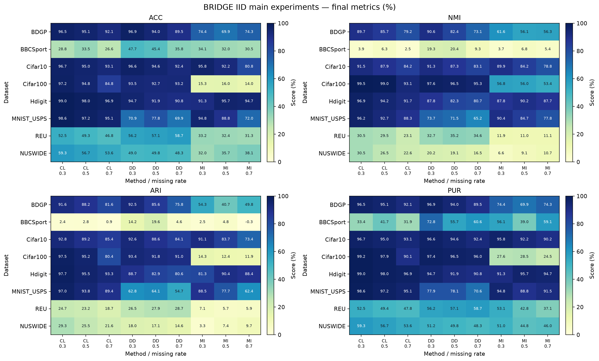
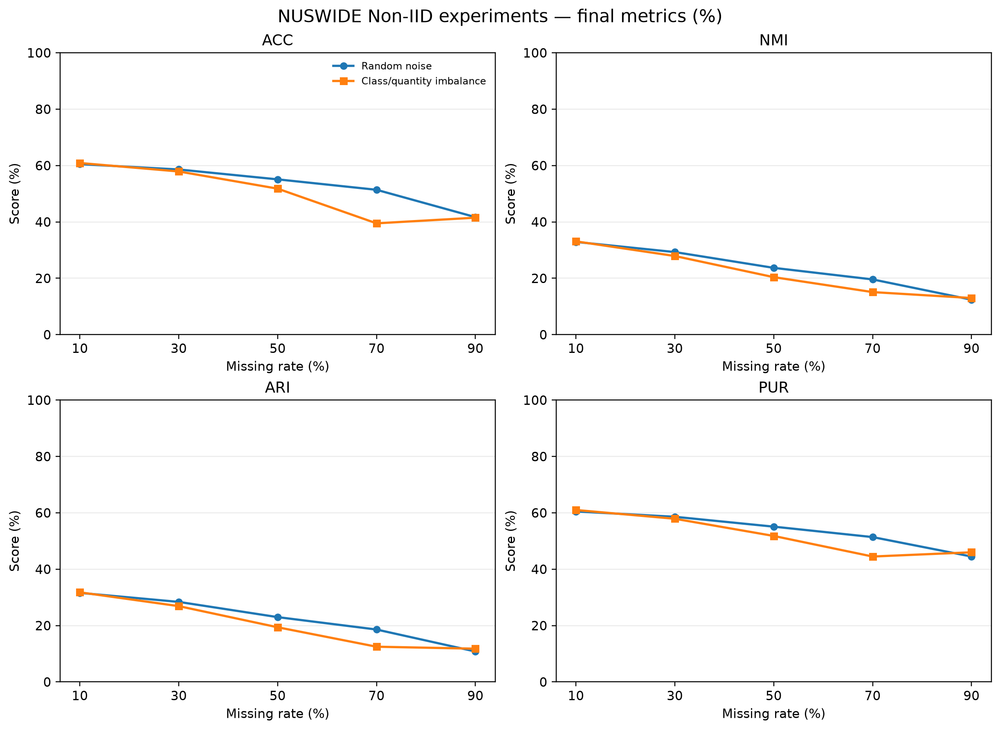

# BRIDGE 复现记录与代码

本仓库整理了 BRIDGE 论文代码的本地复现版本、运行说明和实验结果。上游项目：[xiaorui-jiang/BRIDGE](https://github.com/xiaorui-jiang/BRIDGE)。代码来自本机复现工作目录，包含当前用于实验的改动；复现结果和数据处理方式请以本仓库说明为准。

## 内容

- `train.py`、`dataloader.py`、`loss.py`、`metric.py`、`network.py`：训练、数据载入、损失、指标和网络代码。
- `results_summary.md`：72 组主实验和 10 组 NUSWIDE Non-IID 实验的完整指标及备注。
- `BDGP_result.txt`：BDGP `cp_type=1` 的 seed 级原始结果记录。
- `NON_IID_MODES.md`：Non-IID 两种缺失模式的切换说明。
- `results_data.csv`：从结果汇总表提取的 82 组指标数据。
- `plot_results.py` 与 `figures/`：绘图脚本和实验结果图。
- `requirements.txt`：Python 依赖列表。

原始数据集、模型权重、虚拟环境、缓存和图像文件没有放入仓库。请按上游 README 获取有权使用的数据，并将整理后的文件放入 `data/`。

## 环境

建议使用 Python 3.10–3.12，并安装与本机 CUDA 驱动匹配的 PyTorch。CPU 也可运行，但训练会慢很多。安装依赖：

```bash
pip install -r requirements.txt
```

## 数据文件

训练代码从 `./data/` 读取 `.mat` 文件，文件名及变量布局需与 `dataloader.py` 对应，包括 `BDGP.mat`、`bbcsport.mat`、`Hdigit.mat`、`cifar10.mat`、`cifar100.mat`、`MNIST_USPS.mat`、`REU.mat`、`NUSWIDE.mat`。不同来源的数据文件即使同名，也应先核对变量名和维度。

本次 NUSWIDE 文件由本地 `NUSWIDEOBJ.mat` 转换：从标签 14、19、23、28、29 各按原始顺序取前 1,000 个样本，映射为 5 类，形成 5,000 个样本、5 个视图。这个抽样顺序没有与论文作者的原始 5,000 样本文件核验，因此 NUSWIDE 指标应视作当前数据构造下的复现结果。

Reuters 使用 `Reuters_small.mat` 转换为代码要求的 `REU.mat`。具体字段转换依据见运行记录/本地预处理命令；转换后的数据不是上游数据包的原始文件。

## 运行主实验

命令格式：

```bash
python train.py --dataset Cifar10 --cp_type 1 --miss_rate 0.3
```

`cp_type=1` 为对比学习（CL），`cp_type=2` 为 KL 散度方法（DD），`cp_type=3` 为互信息方法（MI）。主实验网格为 8 个数据集 × 3 种方法 × 3 个缺失率（0.3、0.5、0.7），共 72 组。数据集、每个数据集的固定 seed 和结果见 `results_summary.md`。

PowerShell 批量命令示例：

```powershell
$datasets = 'BDGP','MNIST_USPS','Hdigit','BBCSport','Cifar10','Cifar100','REU','NUSWIDE'
foreach ($d in $datasets) {
  foreach ($cp in 1,2,3) {
    foreach ($m in 0.3,0.5,0.7) {
      python train.py --dataset $d --cp_type $cp --miss_rate $m
    }
  }
}
```

## Non-IID 实验

论文 Figure 3 的 Non-IID 实验单独计数，不包括在 72 组主实验内。结果表记录 NUSWIDE、`cp_type=1`、缺失率 0.1/0.3/0.5/0.7/0.9 下的两种模式，共 10 组；seed 与模式说明在 `results_summary.md`。代码通过 `--non_iid True` 进入 NUSWIDE Non-IID 数据构造。两种模式的切换方式见 `NON_IID_MODES.md`。

## 结果解释与限制

结果是本地单次运行值，除 BDGP `cp_type=1` 的 5-seed 均值与样本标准差外，其余大多是单 seed。NUSWIDE 数据抽样、Reuters 转换和硬件/软件环境与作者原始设置可能不同。完整指标、OOM/负 Loss 等运行备注都收录在 `results_summary.md`。

## 结果可视化

以下图表展示各配置的最终指标，不是随 epoch 变化的训练收敛曲线。重新生成图表：

```bash
python plot_results.py
```

主实验 72 组结果：



NUSWIDE Non-IID 两种缺失模式的指标随缺失率变化：




